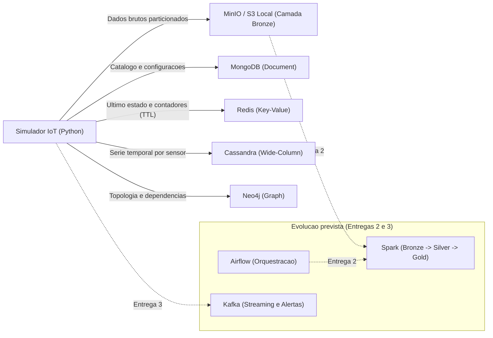

# Arquitetura da Plataforma IoT Industrial — Entrega 1 (Fundação)

Este documento descreve a arquitetura da **Plataforma de Integração de Dados IoT** para monitoramento de linhas de produção industrial, implementada inicialmente com foco na **Entrega 1 (Fundação)**.

## 1. Visão Geral e Fluxo de Dados

Na Entrega 1, o simulador gera eventos contínuos ou em lote representando a operação de linhas, máquinas, peças e sensores industriais (temperatura, vibração e pressão), distribuindo cada tipo de dado para o armazenamento mais adequado ao seu padrão de leitura e escrita (**Persistência Poliglota**).



## 2. Persistência Poliglota: Papel de Cada Banco

| Tecnologia | Categoria NoSQL / Storage | O que armazena | Padrão de acesso principal | Justificativa (CAP / PACELC) |
| :--- | :--- | :--- | :--- | :--- |
| **MongoDB** | Document Store | Catálogo flexível de linhas, máquinas, sensores, especificações e resumo recente | Busca por `machine_id`, `line_id`, `status` e filtros por atributos variáveis | Schema flexível para equipamentos heterogêneos; modelo CP/PC-EC garante consistência no catálogo |
| **Redis** | Key-Value (In-memory) | Última leitura conhecida por sensor, contagem de leituras e alertas ativos | `GET`/`SET`/`HGETALL` por chave exata em latência sub-milissegundo | TTL automático evita crescimento infinito de estado efêmero |
| **Cassandra** | Wide-Column | Histórico operacional de séries temporais de leituras por sensor e dia | Escrita intensiva + leitura por faixa temporal (`sensor_id` + `bucket_date`) | Modelo AP/PA-EL ideal para alta taxa de escrita (`append-heavy`) e escala linear |
| **Neo4j** | Graph Database | Topologia física (`Linha -> Maquina -> Sensor`), peças usadas (`USA`) e dependências (`DEPENDE_DE`) | Travessias multi-hop para análise de impacto e causa raiz | Evita `JOIN`s recursivos ao responder quais máquinas param se uma peça falhar |
| **MinIO** | Object Storage (S3) | Histórico bruto imutável na camada **Bronze** | Escrita em lote/particionada para reprocessamento e analytics (Silver/Gold) | Baixo custo conceitual, formatos abertos e preservação integral do dado bruto (ELT) |

## 3. Modelagem NoSQL Orientada a Consultas (Query-First)

### 3.1 MongoDB (`iot_catalog`)
- **Coleção `machines`**: usa **Embedding** para `specs` (atributos técnicos variáveis) e **Subset Pattern + Computed Pattern** para `recent_alerts` (máximo de 10 alertas recentes, evitando *Unbounded Arrays*) e `metrics_summary` (`total_readings`, `anomaly_count`, `last_reading_at`).
- **Coleção `sensors`**: usa **Extended Reference** embutindo `machine_name` e `line_id` para responder consultas de página do sensor em 1 única query sem `$lookup`.
- **Índices criados (regra ESR — Equality, Sort, Range):**
  - `machines`: índice único em `machine_id`, índice composto `{line_id: 1, status: 1, updated_at: -1}`.
  - `sensors`: índice único em `sensor_id`, índice composto `{machine_id: 1, sensor_type: 1, status: 1}`.

### 3.2 Redis (Estado Rápido e TTL)
- `sensor:latest:<sensor_id>` (Hash): última temperatura, vibração, pressão, status e timestamp com **TTL de 3600s**.
- `sensor:count:<sensor_id>:<YYYYMMDD>` (String/Contador): contador diário atômico via `INCR` com **TTL de 86400s**.
- `alert:active:<machine_id>` (Hash): último alerta de anomalia detectado com **TTL de 1800s**.

### 3.3 Cassandra (`iot_timeseries`)
- **Tabela `sensor_readings_by_day`**:
  - **Partition Key composta:** `((sensor_id, bucket_date))` — o bucket diário evita partições ilimitadas quando um sensor envia leituras por meses.
  - **Clustering Key:** `event_ts DESC` — otimiza consultas de "últimas leituras do sensor no dia".
  - **TTL padrão da tabela:** 30 dias (`default_time_to_live = 2592000`) para controle de ciclo de vida operacional, já que o histórico definitivo fica na camada Bronze do MinIO.

### 3.4 Neo4j (Topologia e Análise de Impacto)
- **Nós (Labels):** `Linha`, `Maquina`, `Sensor`, `Peca`, `Alerta`.
- **Relacionamentos:**
  - `(:Linha)-[:CONTEM]->(:Maquina)`
  - `(:Maquina)-[:TEM_SENSOR]->(:Sensor)`
  - `(:Maquina)-[:USA]->(:Peca)`
  - `(:Maquina)-[:DEPENDE_DE]->(:Maquina)`
  - `(:Sensor)-[:GEROU]->(:Alerta)`
- **Consultas principais:** listar todos os sensores de uma linha e atravessar até 3 níveis de `DEPENDE_DE` para descobrir máquinas impactadas pela falha de uma peça ou máquina upstream.

## 4. Camada Bronze no MinIO (Object Storage)

Seguindo o padrão Medalhão, os dados são gravados na camada Bronze **no formato original enriquecido apenas com metadados técnicos de ingestão** (`ingested_at`, `batch_id`, `source`), sem descartar anomalias ou registros fora de faixa (o saneamento acontecerá na Silver na Entrega 2).

Estrutura do bucket `iot-datalake`:

```text
s3://iot-datalake/
└── bronze/
    └── sensors/
        └── year=2026/
            └── month=11/
                └── day=23/
                    └── hour=11/
                        └── readings_<batch_id>.jsonl
```

Cada lote gera uma chave determinística por `batch_id`, permitindo reprocessamento idempotente sem duplicar arquivos para o mesmo lote.
