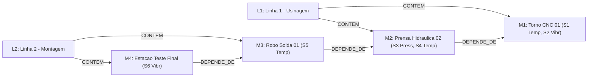

# Catálogo de Domínio da Fábrica Simulada

Este documento descreve todas as entidades, especificações técnicas, sensores, faixas operacionais e regras de classificação de alertas simuladas em [`src/iot_platform/simulator.py`](../src/iot_platform/simulator.py).

## 1. Visão Geral da Planta Industrial

A fábrica simulada possui **2 linhas de produção**, **4 máquinas** encadeadas em sequência operacional, **4 peças críticas** e **6 sensores IoT** medindo **temperatura**, **vibração** e **pressão**.

## 2. Linhas de Produção

| ID | Nome | Setor |
| :--- | :--- | :--- |
| `L1` | Linha 1 - Usinagem | Producao |
| `L2` | Linha 2 - Montagem | Acabamento |

## 3. Máquinas Industriais

| ID | Linha | Nome | Tipo | Criticidade | Especificações (`specs` no MongoDB) | Peças usadas | Depende de |
| :--- | :--- | :--- | :--- | :--- | :--- | :--- | :--- |
| `M1` | `L1` | Torno CNC 01 | `usinagem` | `alta` | `potencia_kw: 18.5`, `fabricante: Romi`, `ano: 2023` | `P1`, `P3` | — |
| `M2` | `L1` | Prensa Hidraulica 02 | `conformacao` | `alta` | `pressao_max_bar: 250`, `fabricante: Schuler`, `ano: 2022` | `P2`, `P4` | `M1` |
| `M3` | `L2` | Robo Solda 01 | `soldagem` | `media` | `eixos: 6`, `fabricante: KUKA`, `ano: 2024` | `P1` | `M2` |
| `M4` | `L2` | Estacao Teste Final | `inspecao` | `alta` | `ciclo_seg: 12`, `fabricante: Siemens`, `ano: 2024` | `P4` | `M3` |

## 4. Peças Críticas

| ID | Nome | Fornecedor | Criticidade | Máquinas que utilizam | Impacto em cascata (até 3 níveis) |
| :--- | :--- | :--- | :--- | :--- | :--- |
| `P1` | Rolamento Principal | SKF | `alta` | `M1`, `M3` | Falha em `M1` impacta `M2`, `M3` e `M4`; falha em `M3` impacta `M4` |
| `P2` | Compressor Hidraulico | Bosch | `alta` | `M2` | Impacta `M3` e `M4` |
| `P3` | Correia Transmissao | Gates | `media` | `M1` | Impacta `M2`, `M3` e `M4` |
| `P4` | Valvula Solenoide | Festo | `alta` | `M2`, `M4` | Falha em `M2` impacta `M3` e `M4` |

## 5. Sensores e Faixas de Operação

| ID | Máquina | Tipo | Unidade | Faixa Normal (`ok`) | Faixa Atenção (`warning`) | Faixa Crítica (`critical`) |
| :--- | :--- | :--- | :--- | :--- | :--- | :--- |
| `S1` | `M1` — Torno CNC 01 | `temperatura` | `C` | `40.0` a `75.0` | `34.75` a `39.99` ou `75.01` a `80.25` | `< 34.75` ou `> 80.25` |
| `S2` | `M1` — Torno CNC 01 | `vibracao` | `mm/s` | `0.5` a `4.5` | `0.0` a `0.49` ou `4.51` a `5.10` | `> 5.10` |
| `S3` | `M2` — Prensa Hidraulica 02 | `pressao` | `bar` | `120.0` a `210.0` | `106.5` a `119.99` ou `210.01` a `223.5` | `< 106.5` ou `> 223.5` |
| `S4` | `M2` — Prensa Hidraulica 02 | `temperatura` | `C` | `45.0` a `80.0` | `39.75` a `44.99` ou `80.01` a `85.25` | `< 39.75` ou `> 85.25` |
| `S5` | `M3` — Robo Solda 01 | `temperatura` | `C` | `35.0` a `70.0` | `29.75` a `34.99` ou `70.01` a `75.25` | `< 29.75` ou `> 75.25` |
| `S6` | `M4` — Estacao Teste Final | `vibracao` | `mm/s` | `0.2` a `3.0` | `0.0` a `0.19` ou `3.01` a `3.42` | `> 3.42` |

## 6. Regra de Classificação de Alertas e Frequência

- **Regra (`classify_reading`):**
  - Se `min_normal <= valor <= max_normal` → **`ok`**.
  - Calculando a tolerância de `15%` sobre a amplitude (`amplitude = max_normal - min_normal`):
    - Se estiver até `15%` fora da faixa normal (limitado a `>= 0.0` no limite inferior) → **`warning`**.
    - Se ultrapassar essa margem de `15%` → **`critical`**.
- **Comportamento da simulação na Entrega 1:**
  - Cada execução de `run_ingestion` gera `--count` leituras por sensor avançando **10 segundos** por passo no `event_ts` (em UTC), com chance configurável de anomalia (`--anomaly-rate`, padrão `0.2`, gerando picos entre `+5%` e `+45%` da amplitude acima de `max_normal`).
